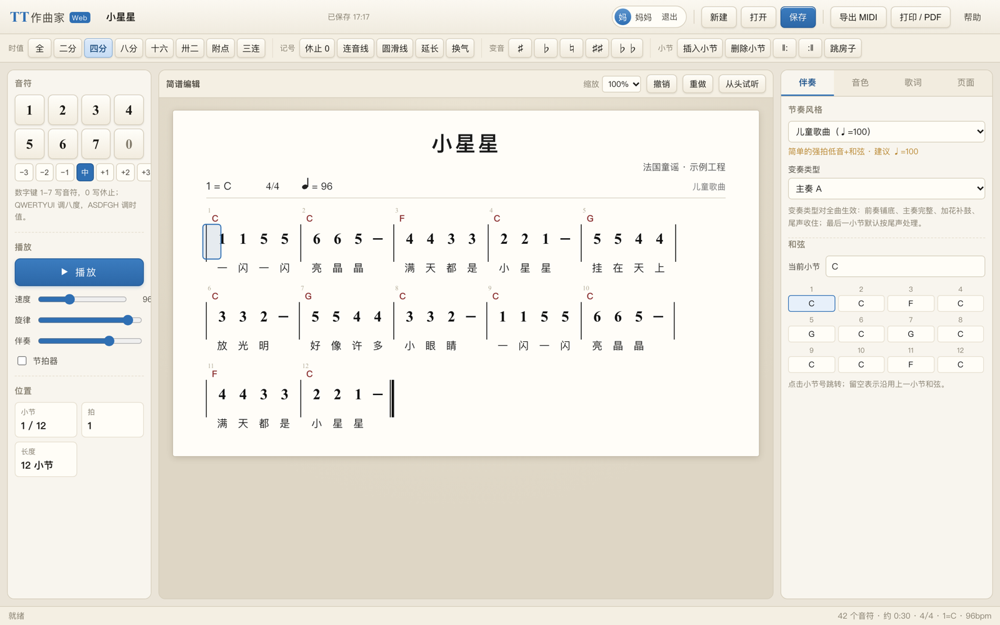
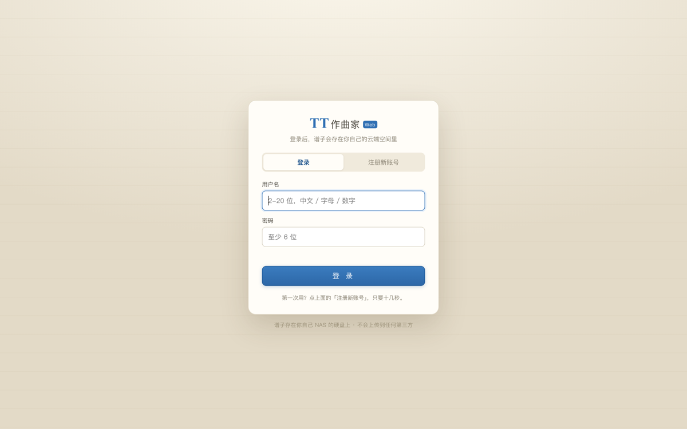

# TT作曲家 Web 版

[](https://github.com/Einsphoton/FakeTTComposer/actions/workflows/docker.yml)

> 把妈妈熟悉的那个「TT作曲家」搬进浏览器：写简谱、自动配伴奏、打印、导出 MIDI。
> 一个 Docker 容器跑在 NAS 上，家里任何一台电脑、平板打开网页就能用，不用装软件、不怕系统升级。
> 每个人用自己的账号登录，谱子存在自己的云端空间里。



---

## 先说清楚：这不是把原版程序塞进容器

原版《TT作曲家》是中音公司在 1990 年代到 2000 年代开发的 Windows 软件（1.2 / 1.25 标准版，安装包只有 6 MB），最后一版更新停在 2017 年。它依赖早期 Windows 的字体、打印和 MIDI 组件，在 Windows 10/11 上经常是「能打开、不能打印」，更别说 ARM 版 Windows。原程序是商业软件，不能反编译，也不适合直接打包分发。

所以这里做的是**按原版的操作逻辑重新写一套 Web 版**：

- **键位完全照搬**：`1-7` 写音符、`ASDFGH` 调时值、`QWERTYUI` 调八度、`ZXCVB` 调变音——妈妈原来怎么弹，现在还怎么弹，不用重新学；
- **保留「简谱编辑 + 自动伴奏 + 打印」的三段式工作流**；
- **简谱排版按中国简谱规范重画**：减时线、增时线、八度点、附点、连音线、圆滑线、延长、换气、反复、跳房子；
- **工程文件、伴奏风格、音色全部是新写的实现**，和原版二进制/数据文件不兼容。

如果你确实需要「和原版一模一样」的排版输出，可以在 NAS 上跑一个 Windows 虚拟机容器（如 `dockurr/windows`）装原版软件，用浏览器远程操作——但需要 KVM 虚拟化、4 GB 以上内存，还要自己解决授权问题，日常写谱打印并不划算。

## 功能对照

| 能力 | 原版 TT作曲家 | 本版 |
| --- | --- | --- |
| 简谱输入 | 鼠标 + 键盘 | 鼠标 + 同样的键盘键位 |
| 时值 | 全 / 二分 / 四分 / 八分 / 十六 / 卅二 + 附点 + 三连音 | ✅ 全部支持 |
| 八度 | 高、低各三个八度 | ✅ |
| 变音记号 | 重降 / 降 / 还原 / 升 / 重升 | ✅ |
| 其他记号 | 休止、连音线、圆滑线、延长、换气 | ✅ |
| 歌词 | 文本框输入，自动对齐 | ✅ 同样的对齐规则 |
| 和弦 | 32 种和弦类型 | 28 种常用类型 + 斜杠低音（C/E） |
| 自动伴奏 | 100 种风格 + 10 种变奏 | 18 种风格 + 10 种变奏（Intro / Main / Fill / Ending） |
| 音色 | 多声部 GM 音色 | 8 种旋律音色 + 贝斯 / 和弦 / 鼓组 |
| 播放 | ✅ | ✅ 浏览器实时合成，光标跟随 |
| 打印 | 所见即所得 | ✅ A4 自动分页，浏览器打印或存 PDF |
| MIDI | 导入 / 导出 | ✅ 导入主旋律轨、导出 5 轨标准 MIDI |
| 工程保存 | 本地文件 | ✅ 账号登录后存在 NAS 上，改完自动保存 |
| 多人使用 | 各人一台电脑各存各的 | ✅ 多账号，每人一个独立空间，互相看不到 |
| 系统要求 | Windows 95 ~ XP | 任何有现代浏览器的设备（电脑 / iPad / 安卓平板） |

**需要说明的差异**：原版的 100 种伴奏风格是厂商的数据文件，无法复制，这里是按常见中国风格重新写的 18 种；原版可以切换五线谱视图，本版专注简谱排版；打印用系统字体，字形和原版不会完全一致；原版近百种民族乐器符号目前实现了常用的一批。

## 三分钟部署

### 方式一：直接拉现成镜像（最省事）

每次提交代码，GitHub Actions 都会自动打包一份镜像推到 GHCR，amd64 / arm64 都有：

```bash
docker pull ghcr.io/einsphoton/fakettcomposer:latest

docker run -d --name ttcomposer \
  --restart unless-stopped \
  -p 8080:8080 \
  -v /volume1/docker/ttcomposer/data:/data \
  -e TZ=Asia/Shanghai \
  -e PUID=1026 -e PGID=100 \
  ghcr.io/einsphoton/fakettcomposer:latest
```

更新版本只要 `docker pull` 再 `docker restart ttcomposer`，数据都在挂载的 `/data` 里，不会丢。

镜像标签的规则：

| 标签 | 含义 |
| --- | --- |
| `latest` | `main` 分支最新一次提交 |
| `1.1.0` / `1.1` | 打了 `v1.1.0` 这类版本标签的发布版（想固定版本、不被更新覆盖就用它） |
| `main` | main 分支最新构建 |
| `sha-1515332` | 某一次具体提交，方便回滚排查 |

> 如果 `docker pull` 提示 `unauthorized`，说明这个包还是私有的：到仓库右侧 **Packages** → 点开镜像 → **Package settings** → **Change visibility** → 选 **Public**，只需要设置一次。之后在任何机器上都能直接拉。

### 方式二：docker compose（要改端口/路径时用）

```bash
cd /你的目录
git clone https://github.com/Einsphoton/FakeTTComposer.git ttcomposer
cd ttcomposer
docker compose up -d
```

`docker-compose.yml` 默认用上面那个 GHCR 镜像；如果你改了代码想用本地源码编译，把里面的 `build: .` 那行取消注释、把 `image:` 那行注释掉，然后 `docker compose up -d --build`。

浏览器打开 `http://NAS的IP:8080`，第一次会看到登录页，点「注册新账号」建一个账号就能用。

### 方式三：自己构建镜像

```bash
docker build -t ttcomposer-web .
```

### 群晖 Synology

1. File Station 里建一个共享文件夹，例如 `docker/ttcomposer/data`；
2. Container Manager → **项目** → **新增** → 选择「上传 docker-compose.yml」，或把整个项目目录传上去后选路径；
3. 端口 8080 如果已被占用（群晖自己常用 5000/5001，但 8080 也常被别的套件占），改成 `8090:8080`；
4. `PUID/PGID` 填拥有该共享文件夹的用户：SSH 登录后执行 `id 你的用户名`，第一行的 `uid=` 和 `gid=` 就是；
5. 启动后访问 `http://群晖IP:8080`。

### 威联通 QNAP

Container Station → **应用程序** → **建立** → 把 `docker-compose.yml` 内容粘进去；把 `./data` 改成 `/share/Container/ttcomposer/data`。

### 环境变量

| 变量 | 默认值 | 说明 |
| --- | --- | --- |
| `PORT` | `8080` | 容器内监听端口 |
| `DATA_DIR` | `/data` | 账号与工程文件目录（务必挂载出来） |
| `PUID` / `PGID` | `1000` | 容器内运行用户，需对数据目录有写权限 |
| `AUTH_USER` / `AUTH_PASS` | 空 | 额外的外层 HTTP Basic 认证（可选）。程序自带账号系统，这个只在「整个站点都不想被公网看到」时再加一层 |
| `TZ` | `Asia/Shanghai` | 时区，影响保存时间显示 |
| `LOG_REQUESTS` | 空 | 设为 `1` 打印访问日志 |

> 程序本身已经要求注册登录，所以直接暴露到公网也能用；但如果要放到公网，建议再加一层 `AUTH_USER` / `AUTH_PASS` 或套在带 HTTPS 的反向代理后面（HTTPS 下会话 Cookie 会自动加上 `Secure`）。

## 账号与多人使用

第一次打开网页是登录页：



- **注册**：点「注册新账号」，填用户名（2-20 位，中文 / 字母 / 数字 / 下划线）、昵称（显示在右上角，可以写「妈妈」）、密码（至少 6 位）。注册完自动登录。
- **云端存储**：每个账号有自己的空间，别人登录进来看到的是他自己的作品，看不到你的。换一台电脑、换一个浏览器，只要用同一个账号登录就能接着写。
- **登录状态**：登录后 30 天内不用重新输密码，浏览器关掉再开也还是登录着的。右上角「退出」可以随时切换账号。
- **改密码**：右侧「页面」标签页最下面的「修改密码」，需要先输原密码。
- **旧版本升级**：从没有账号系统的旧版本升级上来时，`/data` 根目录下的旧工程会**自动交给第一个注册的账号**（注册成功时会提示「已接管 N 个旧作品」），不会丢。
- **忘记密码**：目前没有邮箱找回。可以在 NAS 上停掉容器，删掉 `/data/users.json`（账号表），重新注册——工程文件在 `/data/projects/<用户ID>/` 里，删账号表不会删谱子，但需要手动把文件夹改名到新账号的 ID 下才能看到。建议把密码记在家庭共享的密码本里。
- **安全措施**：密码用 scrypt 加盐哈希存储（不存明文）；会话是 HMAC-SHA256 签名的 HttpOnly Cookie；同一 IP 对同一用户名连续输错 8 次密码会锁 5 分钟；每个 IP 每小时最多注册 20 个账号。

## 数据与备份

- 目录结构：`/data/users.json`（账号表）、`/data/secret.key`（会话签名密钥）、`/data/projects/<用户ID>/<工程ID>.json`（每个用户的每个作品一个 JSON 文件）；
- 工程是纯文本 JSON，随时可以打开看、可以手工改；
- **备份整个 `/data` 目录**就能连账号和作品一起备份；建议加进 NAS 的 Hyper Backup / 快照计划；
- 只想备份某个作品：右侧「页面 → 导出工程」下载 `.json`，换机器时用「导入工程」恢复；
- 断电、容器重建都不会丢谱子（只要 `data` 目录挂载在 NAS 上）。

> `secret.key` 决定登录 Cookie 的签名。删掉它所有设备都需要重新登录，账号和作品不受影响。

## 使用说明

### 键盘（与 TT作曲家 1.25 相同）

| 按键 | 作用 |
| --- | --- |
| `1` ~ `7` | 输入音符 1-7 |
| `0` | 输入休止符 |
| `A` `S` `D` `F` `G` `H` | 全音符 / 二分 / 四分 / 八分 / 十六分 / 三十二分 |
| `Q` `W` `E` `R` `T` `Y` `U` | 低三个八度 … 中音 … 高三个八度 |
| `Z` `X` `C` `V` `B` | 重降 / 降 / 还原 / 升 / 重升 |
| `空格` | 播放 / 停止 |
| `←` `→` | 移动光标 |
| `↑` `↓` | 上一小节 / 下一小节 |
| `Backspace` | 删除前一个音符 |
| `.` | 加 / 去附点 |
| `Insert` | 切换「插入 / 覆盖」模式 |
| `Ctrl+Z` / `Ctrl+Shift+Z` | 撤销 / 重做 |
| `Ctrl+S` | 保存 |

### 写第一首

1. 右上角「新建」；
2. 在「页面」里设好调号（1=C）、拍号、曲名；
3. 直接敲数字键写音符，一个音符写完光标自动往后走，小节写满自动进下一小节；
4. 右侧「伴奏」里选一个节奏风格，再给每小节填上和弦（C、Am、G7…）；
5. 按空格试听，觉得速度不对就拖「速度」滑块；
6. 点「打印 / PDF」，在打印对话框里选「另存为 PDF」。

鼠标也能干活：点谱面上的音符可以选中，选中后输入数字会**直接替换**这个音（改错音最顺手），改时值、八度、变音也只影响这一个音；点小节空白处把光标放到该小节末尾，之后输入就是**插入**，后面的音符自动往后挪、超出小节会顺推到下一小节。按 `Insert` 可以在「插入 / 覆盖」之间切换。

### 歌词

在右侧「歌词」里直接粘贴整段歌词，自动对齐：

- 一个汉字（或一个英文单词）对应一个音符；
- 一个空格让下一个字往后空一个音符；
- 回车另起一段（从下一小节开始）；
- 标点自动贴在前一个字后面。

### 和弦写法

`C`、`Am`、`G7`、`Cmaj7`、`Dm7b5`、`F#m7`、`Bb`、`C/E`（斜杠表示低音）都可以。
小节里留空就沿用上一小节的和弦。

### 自动伴奏

伴奏不是音频文件，而是按「风格 + 和弦」实时算出来的：贝斯走根音、和弦按节奏型铺、鼓组按风格打点。所以：

- 改和弦、改速度、改风格，立刻就能听到变化；
- 导出 MIDI 时分成「主旋律 / 贝斯 / 和弦 / 鼓组」四条轨道，可以在 Cubase、Logic、MuseScore 里继续精修；
- 变奏类型（前奏 A / 主奏 A / 加花 AA / 尾声 A …）控制的是编配密度，最后一小节默认走尾声。

### MIDI 导入

「页面 → 导入 MIDI 旋律」：挑出最像主旋律的那条轨（复调率最低、音符最多），按十六分音符量化，再把音高换算成简谱级数和变音记号。适合把以前在别的软件里做的曲子拿回来改。

## 常见问题

**打不开 / 端口冲突**
把 compose 里的 `8080:8080` 改成 `8090:8080`，然后访问 8090。容器日志里会明确提示「端口已被占用」。

**保存失败 / 提示权限不足**
`PUID` / `PGID` 和数据目录的属主不一致。SSH 执行 `sudo chown -R 1026:100 /volume1/docker/ttcomposer/data`（数字换成你的），或在 compose 里改对 PUID/PGID 后重启。

**没有声音**
浏览器要求先有一次点击才能出声，点一下「播放」即可；iPad 注意侧边静音开关；Safari 需要在设置里允许自动播放。

**打印是空白 / 排版不对**
用 Chrome 或 Edge 打印；在打印对话框里把「边距」设为「无」，勾选「背景图形」，纸张 A4 纵向。

**手机上能用吗**
能。窄屏时右侧面板会收起来，点谱面工具条上的「伴奏 / 音色」按钮展开。写谱建议还是用电脑或平板。

**两个人同时改一份谱子会怎样**
不会互相干扰：每个账号只看到自己的作品。同一个账号在两台设备上同时打开同一份谱子时，后保存的会覆盖先保存的，建议一人一份工程。

**登录页一直转 / 提示连不上服务器**
容器还没起来，或者反向代理没把 `/api/` 转发过去。先在 NAS 上执行 `curl http://127.0.0.1:8080/api/health`，正常会返回 `{"ok":true,...}`。

## 技术说明

- **服务端**：零依赖 Node.js（只用标准库），静态文件 + 账号 + 工程 JSON 的 REST 接口，原子写入（先写临时文件再改名，断电不会写坏）；
- **账号**：scrypt 加盐哈希存密码，HMAC-SHA256 签名的 HttpOnly `SameSite=Lax` 会话 Cookie（30 天），登录失败限流；
- **前端**：原生 JavaScript，无构建步骤。简谱排版是自己写的 SVG 排版引擎，播放用 Web Audio 实时合成，MIDI 用自己写的 SMF 编码器；
- **镜像**：`node:20-alpine`，非 root 运行，带 healthcheck，amd64 / arm64 都能跑（群晖 ARM 机型也可以）；
- **CI**：`.github/workflows/docker.yml`，每次 push 到 `main` 或打 `v*` 标签，自动构建 amd64 + arm64 双架构镜像推到 GHCR，并打上 `latest` / 分支名 / 版本号 / `sha-xxxx` 标签。

```
.
├── server.js              # 服务端（静态资源 + 账号 API + 工程 API + 可选 Basic 认证）
├── public/
│   ├── index.html
│   ├── css/app.css
│   └── js/
│       ├── model.js       # 乐谱数据模型、和弦解析、歌词对齐
│       ├── styles.js      # 18 种伴奏风格 + 变奏生成
│       ├── render.js      # 简谱 SVG 排版引擎（屏幕 + A4 分页）
│       ├── audio.js       # Web Audio 合成器与播放器
│       ├── midi.js        # MIDI 导出
│       ├── midi-import.js # MIDI 导入（量化 + 音级换算）
│       └── app.js         # 界面、编辑逻辑、登录与工程管理
├── Dockerfile
├── docker-compose.yml
├── .github/workflows/docker.yml  # 提交即自动构建双架构镜像推到 GHCR
├── LICENSE
└── docs/                  # 界面与登录截图
```

本地开发（不用 Docker）：

```bash
node server.js          # 默认 http://localhost:8080
PORT=8090 node server.js
```

## 许可

代码以 MIT 许可发布。「TT作曲家」名称及相关商标归中音公司所有，本项目是非官方的兼容实现，不包含原版任何代码或数据文件。示例曲《小星星》为公有领域作品。
